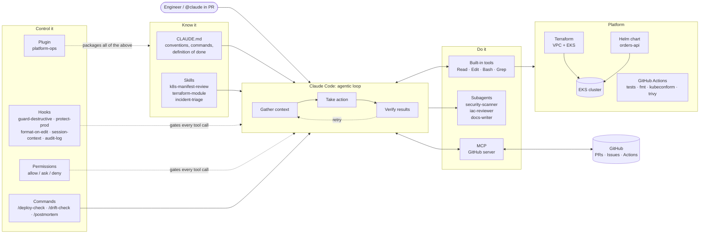

# Agentic DevOps Platform

**An AWS/EKS platform repo with a guardrailed AI platform engineer built in.**

This repo is two things at once:

1. **A real platform**: Terraform (VPC + EKS), a containerized Python service deployed with Helm, and GitHub Actions CI with security scanning.
2. **A production-style [Claude Code](https://docs.claude.com/en/docs/claude-code/overview) setup** that turns an AI coding agent into a platform engineer that knows the team's conventions, delegates reviews to specialist subagents, connects to GitHub, and **cannot** run destructive commands, because deterministic hooks block them.

The goal: show how to give an AI agent real autonomy on infrastructure **without** giving up safety, the same way you'd onboard a new engineer with runbooks, least privilege, and review gates.

---

## Architecture



### How each building block is used here

| Building block | File(s) | What it does in this repo |
|---|---|---|
| **Context** | [`CLAUDE.md`](CLAUDE.md) | Repo map, build/test commands, coding standards, hard rules, definition of done |
| **Skills** | [`.claude/skills/`](.claude/skills) | `k8s-manifest-review` (with a runnable policy checker), `terraform-module`, `incident-triage` |
| **Subagents** | [`.claude/agents/`](.claude/agents) | `security-scanner` (read-only, Trivy/Checkov), `iac-reviewer` (blast radius + cost), `docs-writer` (cheap model) |
| **Tools + Permissions** | [`.claude/settings.json`](.claude/settings.json) | Plan/lint/read freely; ask before push or prod edits; deny apply/destroy/delete and secret reads |
| **MCP** | [`.mcp.json`](.mcp.json) | GitHub MCP server for PRs, issues and Actions (token from `$GITHUB_PAT`, never committed) |
| **Hooks** | [`.claude/hooks/`](.claude/hooks) | Block destructive infra commands, require approval for prod edits, auto-format, inject live git context, audit every turn |
| **Commands** | [`.claude/commands/`](.claude/commands) | `/deploy-check <chart> <env>`, `/drift-check <env>`, `/postmortem <incident>` |
| **Plugin** | [`plugin/`](plugin) + [`.claude-plugin/marketplace.json`](.claude-plugin/marketplace.json) | The whole setup packaged so any team can install it in one command |
| **CI agent** | [`.github/workflows/claude.yml`](.github/workflows/claude.yml) | `@claude` in a PR runs the same agent, with the same guardrails, in GitHub Actions |

---

## Guardrails: defense in depth

An agent with shell access to infrastructure needs layered controls. This repo uses three, from soft to hard:

| Layer | Mechanism | Strength | Example |
|---|---|---|---|
| 1. Instructions | `CLAUDE.md`, skills | Advisory (model judgment) | "Never run terraform apply" |
| 2. Permissions | `settings.json` allow/ask/deny | Enforced by the harness | `deny: Bash(terraform apply:*)` |
| 3. Hooks | `PreToolUse` scripts | Enforced, even with `--dangerously-skip-permissions` | `guard-destructive.sh` exits 2 and tells the agent why |

Hooks are tested like any other code ([`tests/test_hooks.sh`](tests/test_hooks.sh)):

```
guard-destructive.sh
  PASS  blocks terraform apply
  PASS  blocks kubectl -n x delete
  PASS  blocks chained apply
  PASS  allows terraform plan
  ...
protect-prod.sh
  PASS  asks for prod tf edit
  PASS  denies .env edit
17 passed, 0 failed
```

The Kubernetes policy checker used by the skill also runs in CI, so the agent and the pipeline enforce **the same standard**:

```
CRITICAL | Deployment/bad:web | runAsNonRoot not set
HIGH     | Deployment/bad:web | image not pinned (nginx:latest)
CRITICAL | Deployment/bad:web | privileged container
1 documents checked, 6 HIGH/CRITICAL findings
```

---

## Repository layout

```
.
├── CLAUDE.md                     # agent's project memory
├── .claude/
│   ├── settings.json             # permissions + hook wiring
│   ├── hooks/                    # guardrail + automation scripts
│   ├── skills/                   # on-demand expertise (+ bundled scripts)
│   ├── agents/                   # specialist subagents
│   └── commands/                 # /deploy-check, /drift-check, /postmortem
├── .mcp.json                     # GitHub MCP server
├── plugin/                       # generated plugin package (scripts/build-plugin.sh)
├── .claude-plugin/marketplace.json
├── app/                          # orders-api (Flask) + Dockerfile + tests
├── charts/orders-api/            # Helm chart, dev + prod values
├── terraform/
│   ├── modules/{vpc,eks}/        # wrappers over terraform-aws-modules
│   └── envs/{dev,prod}/          # env roots, S3 backend, default_tags
├── .github/workflows/            # ci.yml, claude.yml
├── tests/test_hooks.sh
└── docs/
```

---

## Try it

### Prerequisites
Claude Code, `jq`, Python 3.12, and (for full checks) Terraform ≥ 1.6, Helm 3, kubeconform, Trivy.

```bash
git clone https://github.com/<you>/agentic-devops-platform && cd agentic-devops-platform
export GITHUB_PAT=<fine-grained token>   # for the GitHub MCP server
make check                               # tests, fmt, validate, lint, policy, hook tests
claude                                   # start the agent in this repo
```

### Demo scenarios
See [`docs/demo-walkthrough.md`](docs/demo-walkthrough.md) for scripted demos:

1. **Guardrail demo**: ask the agent to "apply the prod Terraform" and watch the hook block it and the agent fall back to a plan.
2. **Feature with review**: "Add a PodDisruptionBudget to dev and open a PR". Uses a skill, a subagent and the GitHub MCP server.
3. **Pre-deploy gate**: `/deploy-check orders-api prod`.
4. **Incident triage**: "orders-api pods are CrashLooping in dev" with the read-only triage skill.

### Install the plugin in another repo
```bash
/plugin marketplace add <you>/agentic-devops-platform
/plugin install platform-ops@agentic-devops
```

---

## Design decisions

- **Hooks over instructions for safety.** Anything that must never happen is enforced in code. Instructions explain *why*; hooks guarantee *that*.
- **Read-only subagents.** Reviewers get `Read, Grep, Glob, Bash` but no `Edit`, so a review can't silently change code. Their context stays isolated, and only the verdict returns to the main session.
- **One policy, two enforcers.** `check-manifests.sh` runs in the skill *and* in CI, so humans and the agent are held to the same bar.
- **Plugin generated, not hand-maintained.** `.claude/` is the source of truth; `scripts/build-plugin.sh` produces `plugin/` and CI fails if it drifts.
- **Secrets never in the repo.** MCP token via env var; hooks deny edits to `.env`, `*.pem`; permissions deny reading them.

## Tech stack
AWS (VPC, EKS, IRSA, KMS, ECR) · Terraform · Kubernetes · Helm · Docker · Python/Flask · GitHub Actions · Trivy · kubeconform · Claude Code (skills, subagents, hooks, MCP, plugins)

## Author
**Venkat Ram Reddy** · DevOps / Platform Engineer · AWS Certified DevOps Engineer – Professional · CKA
