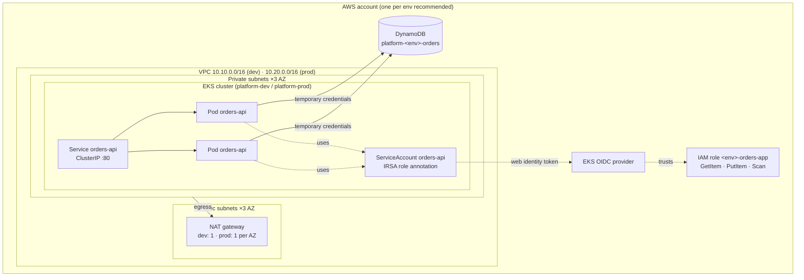

# Architecture

## Overview

The repository has two halves that work together:

1. **The platform**: AWS infrastructure (Terraform), a containerized service
   (`orders-api`), its Helm chart, and CI.
2. **The agent**: Claude Code configured as a platform engineer (`.claude/`), with
   guardrails enforced by hooks and permissions, and packaged as a plugin (`plugin/`).

## Components

| Component | Where | Purpose |
|---|---|---|
| VPC | `terraform/modules/vpc` | 3 private subnets (`/20`) for nodes, 3 public subnets (`/24`) for NAT and load balancers. Subnets are tagged for the AWS Load Balancer Controller. |
| EKS | `terraform/modules/eks` | Managed control plane, one managed node group, IRSA enabled, Kubernetes secrets encrypted with KMS, core add-ons (CoreDNS, kube-proxy, VPC CNI, Pod Identity Agent). |
| Bootstrap | `terraform/bootstrap` | Once per account: KMS-encrypted state bucket, lock table, ECR repository, GitHub OIDC provider and the CI role that may only push images. |
| Argo CD | `terraform/envs/dev/argocd.tf` | Installed by Terraform (Helm); an Application syncs `charts/orders-api` from `main` into dev with automated prune and self-heal. |
| Orders table | `terraform/modules/orders-table` | DynamoDB table (on-demand, point-in-time recovery, deletion protection, encrypted) and the IRSA role orders-api assumes. |
| orders-api | `app/` | Flask app served by gunicorn (2 workers × 4 threads), non-root, read-only root filesystem. |
| Helm chart | `charts/orders-api` | Deployment, Service, ServiceAccount, optional HPA and PodDisruptionBudget. |
| CI | `.github/workflows/ci.yml` | 6 jobs on every PR and on pushes to `main`. |
| Release | `.github/workflows/release.yml` | On merges touching `app/`: test, build, push to ECR via OIDC, commit the new tag to `values-dev.yaml`. |
| PR assistant | `.github/workflows/claude.yml` | `@claude` in a PR or issue comment runs Claude Code in Actions with the same config. |
| Agent config | `.claude/` | Context (`CLAUDE.md`), permissions, hooks, skills, subagents, commands. |
| Plugin | `plugin/`, `.claude-plugin/marketplace.json` | `.claude/` packaged for installation in other repos. Generated, never hand-edited. |

## Request flow

1. A client reaches the `orders-api` Service. The Service is `ClusterIP`, so today that
   means from inside the cluster or through `kubectl port-forward` (no Ingress yet).
2. The Service load-balances across ready pods. A pod is **ready** only when
   `ORDERS_TABLE` is configured (`GET /readyz` returns 200).
3. The pod handles the request:
   - `POST /orders` validates input, generates a UUID, and does a conditional `PutItem`.
   - `GET /orders/<id>` does a strongly consistent `GetItem`.
   - `GET /orders` paginates a `Scan` and sorts by `created_at`.
4. AWS SDK calls are signed with temporary credentials obtained through IRSA (below).
   Timeouts are 2 s connect and 5 s read, with 3 attempts in standard retry mode.
5. If DynamoDB fails, the response is `503 {"error": "storage unavailable"}` and the
   error is logged.

## Identity: how a pod gets DynamoDB access (IRSA)

1. Terraform creates an IAM role `platform-<env>-orders-app` whose trust policy accepts
   `sts:AssumeRoleWithWebIdentity` only from the cluster's OIDC provider, only for the
   subject `system:serviceaccount:orders-api:orders-api`, and only for the audience
   `sts.amazonaws.com`.
2. The role's only permissions are `dynamodb:GetItem`, `PutItem` and `Scan` on that one
   table (plus `kms:Decrypt`/`GenerateDataKey` on the key if a customer-managed key is used).
3. Helm puts the role ARN on the ServiceAccount as `eks.amazonaws.com/role-arn`.
4. When a pod starts, EKS injects a projected, short-lived service account token and the
   `AWS_ROLE_ARN` / `AWS_WEB_IDENTITY_TOKEN_FILE` environment variables.
5. boto3's default credential chain exchanges the token for temporary credentials, and
   refreshes them automatically.

Effect: no static keys anywhere; another workload on the same cluster, or this workload
in another namespace, cannot use the role.

## Environments

| | dev | prod |
|---|---|---|
| Cluster | `platform-dev` | `platform-prod` |
| VPC CIDR | `10.10.0.0/16` | `10.20.0.0/16` |
| NAT gateways | 1 shared | 1 per AZ (HA) |
| Kubernetes API | Public, limited to `api_allowed_cidrs` | Private only |
| Nodes | `t3.large` **Spot**, 1–3 (2 desired) | `t3.large` On-Demand, 3–10 (3 desired) |
| Orders table | `platform-dev-orders` | `platform-prod-orders` |
| App replicas | 1 | HPA 3–12 at 65 % CPU, PDB `minAvailable: 2` |
| Pod resources | 100m/128Mi request, 500m/256Mi limit | 250m/256Mi request, 1 CPU/512Mi limit |
| Config | `values.yaml` | `values.yaml` + `values-prod.yaml` |
| Change control | Normal PR | PR + human approval (hooks) + plan attached |

## Design decisions

| Decision | Why | Trade-off |
|---|---|---|
| **DynamoDB over RDS** | No servers, passwords or VPC wiring; ~$0 idle with on-demand billing; IRSA fits the "pod-level AWS access" rule | Key-value access patterns only; list needs a scan or index |
| **UUID order IDs** | DynamoDB has no auto-increment; UUIDs need no coordination between pods | IDs are not human-friendly or ordered |
| **Readiness checks config, not DynamoDB** | A brief AWS blip should not pull every pod out of the Service at once | A pod with bad IAM is "ready" but returns 503s; watch logs and error rate |
| **No default table name in the chart** | prod inherits `values.yaml`; a default would point prod at dev's table | Every deploy must set it (prod sets it in `values-prod.yaml`) |
| **One cluster per environment** | Blast-radius isolation between dev and prod | Two control planes to pay for |
| **Private nodes, public subnets only for LBs/NAT** | Nodes are never directly reachable | NAT gateway cost |
| **Hooks over instructions** | Instructions can be ignored; hooks are enforced in code | Pattern matching has limits (see [Claude Code setup](claude-code.md#limits)) |
| **GitOps (pull) delivery** | CI never needs Kubernetes API access, so dev's API stays allow-listed; git is the record of what runs | Up to ~3 min sync delay; the bot commits tag bumps to `main` |
| **Account ID kept out of git** | The repo is public; Terraform injects the registry URL and role ARN into the Argo CD Application | Values live in two places (git + Terraform) |
| **Plugin generated from `.claude/`** | One source of truth; CI fails if `plugin/` drifts | Must run `make plugin` after editing `.claude/` |
